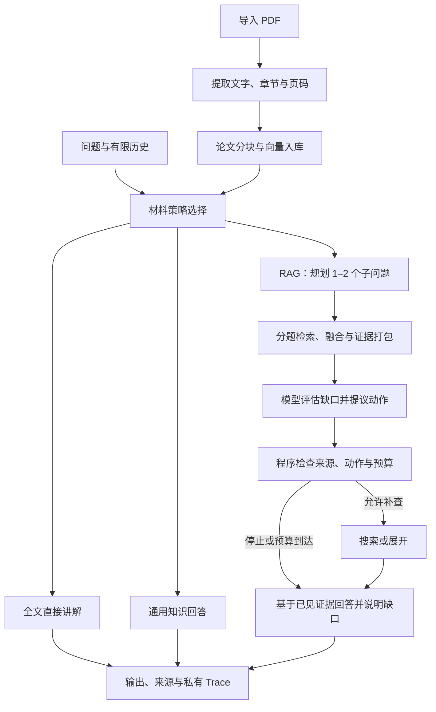

# Research Copilot

**一个可追踪、受预算约束的科研论文阅读 Agent。**

导入 PDF，围绕论文进行整体导读或局部追问。项目同时提供全文阅读与 RAG 路径：需要广泛上下文时阅读完整解析文本，需要聚焦查证时检索片段，并允许模型在有限预算内提出补查或展开建议。

除了生成答案，也保留产生答案的过程：用了哪些证据、模型判断缺什么、程序执行了什么、为什么停止，以及实际调用与 Token 消耗。

适合用来学习 **PDF/RAG 数据链路、受控单 Agent 编排、结构化输出、Trace、对照评测与本地容器交付**。

> 当前为单用户、本地演示版本。已完成真实 PDF 导入、问答及容器重建持久化验收；回答仍存在召回遗漏与理解偏差，尚未公网上线。

[快速开始](#快速开始) · [工作流](#工作流) · [评测与实验](#评测与实验) · [代码导航](#代码导航) · [已知边界](#已知边界)

## 可以做什么

- **论文导入**：本地上传 PDF，提取章节与物理页码，分块后保存至 Chroma，按论文会话隔离来源。
- **整体导读与局部追问**：支持全文阅读、片段检索、通用知识及规则驱动的自动选择；材料策略与讲解深度分别设置。
- **受控补查**：RAG 路径由模型拆解问题、评估已见证据并提议 `search / expand / stop`，程序检查动作、来源和预算后执行。
- **可展开的出处**：正文使用简短章节/页码，详细片段按需查看；输出协议要求区分论文事实、教学解释与推断。
- **有限回答与降级**：保留有依据的可用内容，披露未覆盖的问题；部分格式错误或输出截断不必导致整份答案丢失。
- **私有 Trace**：管理员按请求查看证据、模型提议、门禁决定、工具结果和停止原因，用户页面不堆积调试信息。

示例提问：

> 请讲解 Autoformer 的核心思想：它解决什么问题，各组件起什么作用，怎样组成预测流程。公式只解释作用。
>
> 进一步解释 Auto-Correlation 如何寻找时间延迟，只讲机制与直觉，不重复背景。
>
> 作者明确讨论了哪些适用条件？请把原文陈述、基于方法的推断与改进建议分开。

## 工作流



**模型负责语义判断，程序负责执行约束。** 来源 ID 合法只说明引用来自本轮已提供材料，不能证明它在语义上支持结论；充分性仍可能被模型误判。

普通 RAG 默认安排三次生成调用：规划、评估、最终写作，中间允许一次补查或展开阶段。停止补查后仍会尝试回答已有依据的部分，不通过自评分阈值触发循环重写。

### 材料策略与讲解深度

| 选择 | 实际行为 |
|---|---|
| `auto` 自动选择 | 按问题范围、论文大小及粗略输入成本规则选择全文或 RAG，可能误判 |
| `fast` 快速检索 | 走受控 RAG；不保证真实耗时一定比全文更短 |
| `deep` 全文阅读 | 单篇资料在来源限额内时走全文，超限则选择 RAG |
| 未选择论文 | 通用知识模式，不作为当前 PDF 的事实核验 |
| `concise / beginner / advanced` | 分别控制简短、入门、深入的表达与输出上限，与材料策略独立 |

内部 `mode=paper_full` 表示全文，`mode=paper_deep` 表示受控 RAG。全文路径通常一次写作调用；结构化资料表是实验开关，未作为默认。默认也不因 `partial` 状态自动追加一次全文请求。

## 关键设计

### 检索、证据与上下文

- PyMuPDF 提取正文，清理重复页眉页脚，识别常见章节并保留页码；全文阅读也基于这些解析结果，不等同于视觉读取 PDF。
- Chroma 底层提供语义候选与 MMR 筛选；新版适配器补充手写 BM25 式词项打分、章节及组件名匹配规则。
- 多子问题各自检索，合并时保留覆盖份额并使用 RRF 排名分数；词项/语义组合与子问题融合是不同层次的逻辑。
- 证据按单段、唯一块数和总字符预算打包；近期问答作为有限背景，原文片段不不断追加到会话历史。

当前没有 Cross-Encoder 精排。关键词覆盖、来源身份校验与最终语义正确性分别评估，不将其中一项当作另一项的保证。

### 预算与停止条件

默认 RAG 约束见 [`ResearchBudget`](deep_research.py)：

| 约束 | 默认值 |
|---|---:|
| 生成模型调用 | 3 次，辅助审阅关闭时 |
| 检索/展开动作阶段 | 2 个，包含首轮 |
| 唯一证据块 | 8 个 |
| 单次提供的文本段 | 最多 600 字符 |
| 首轮 / 总证据预算 | 4000 / 6000 字符 |
| 整次 RAG 请求时限 | 180 秒 |
| 深入论文讲解输出 | 6400 Token，含序列化包装 |

一次首轮动作可能包含两个子查询，因此动作数不等于底层检索次数。字符上限也不是精确 Token 计数。全文有独立来源上限，默认单篇正文 100000 字符、200 块，并受自动选择的成本规则约束。

### 对失败进行分类处理

| 失败情况 | 处理思路 |
|---|---|
| 原文反驳用户前提 | 使用 `refuted_premise`，与论文证据内部冲突区分 |
| 某个子问题评估字段异常 | 隔离异常项；满足条件时保留其他可回答部分并标记降级 |
| 模型决定停止但仍有缺口 | 结束补查，最终写作披露缺口，不强制改成继续搜索 |
| 长条目或部分输出不合规 | 在允许范围内分段或保留合法条目，不让单条异常连带丢弃全部正文 |
| 输出上限造成 JSON 截断 | 只恢复已闭合且来源身份校验通过的完整条目，不拼接未知内容 |
| 引用了其他论文或未见来源 | 保留硬性来源检查，不为了展示答案绕过它 |

`ok`、`partial`、`insufficient` 是执行与覆盖状态，不是答案质量分数。“当前没检索到”也不能推导为“论文没有写”。

## 评测与实验

评测分为三层：离线测试检查程序契约；固定任务对照观察行为、成本与失败；人工阅读核对关键事实、解释和引用。Trace 用于定位原因，不替代质量评审。

### 已完成的开发实验

| 实验 | 规模与控制 | 观察与取舍 |
|---|---|---|
| 论文开发集 | 9 篇时间序列论文、72 题，参考标注由 AI 辅助生成 | 用于开发诊断，不宣称专家金标准 |
| 检索组件消融 | 72 题，同候选池、同证据预算，纯向量排序 vs MMR | 联合命中 14/72 vs 13/72；MMR 带来 6 题改善、7 题退化，未观察到稳定收益 |
| 证据预算回放 | 固定候选和排序，改变单段/总证据预算 | 区分候选、选择与打包截断损失，不把多装关键词当作语义提升 |
| 三方案答案对照 | 8 题分两批，对照旧 V1 受控适配器、auto、直接全文 | 保留失败和不适用样本；全文通常更详尽，auto 仍有召回与充分性问题，未证明一致胜出 |
| 本地容器验收 | 真实 PDF 导入、整体与局部问答、Trace 查看、容器重建 | 验证链路与持久化，不作为生产可用性或答案准确率证明 |

三方案两批之间存在修复，不能合并包装为同一冻结版本的统一准确率。离线命中、模型自评与人工质量判断分别保留；LLM-as-a-Judge 只作辅助，未用未经校准的分数驱动自动重写。

**离线回归记录（2026-10-14）**：合并后的 main 运行 212 项测试，210 项通过，2 项因私有真实响应 fixture 未随仓库提供而跳过，无失败。这是当次验收记录，最新结果以实际运行与 [CI](.github/workflows/ci.yml) 为准。

真实论文、AI 辅助标注集、模型原始回答、盲审映射及私有 Trace 不随仓库分发；干净克隆不能直接复现这些历史质量数字。公开脚本与合成样例可用于理解协议，再使用自己的合法语料建立评测。

## 快速开始

推荐 Python 3.12（与 Docker / CI 配置一致）。以下以 Windows PowerShell 为例，在项目根目录执行。

### 1. 安装依赖

```powershell
python -m venv .venv
.\.venv\Scripts\python.exe -m pip install -r requirements.txt
Copy-Item .env.example .env
```

若已有 `.env`，保留现有配置，不重复复制覆盖。Linux/macOS 可使用 `python3 -m venv .venv`，后续解释器改为 `.venv/bin/python`。

### 2. 配置生成与嵌入服务

编辑 `.env`，参考 [配置模板](.env.example)：

| 配置 | 用途 |
|---|---|
| `OPENAI_BASE_URL`、`MODEL_NAME` | 生成接口与账户已开通的模型 ID |
| `DEEPSEEK_API_KEY` / `OPENAI_API_KEY` | 与所选提供商匹配的生成密钥；阿里云主机使用 `DASHSCOPE_API_KEY` |
| `DASHSCOPE_BASE_URL`、`DASHSCOPE_API_KEY` | 独立的嵌入连接；当前 `rag_store.py` 使用 `qwen3.7-text-embedding-flash`，接口需支持该模型 |
| `DEEP_RESEARCH_API_TOKEN` | 本地研究/管理入口令牌，与模型服务商密钥不同 |
| `RESEARCH_QUALITY_REVIEW=0` | 初次运行关闭额外辅助审阅，使调用路径更容易观察 |

生成连接也支持 `RESEARCH_BASE_URL / RESEARCH_MODEL_NAME / RESEARCH_API_KEY` 覆盖；它们优先于共享配置。切换提供商时核对完整配置并重启，不混用不同服务商的密钥。连接策略见 [`research_model_settings.py`](research_model_settings.py)。

本地入口令牌至少 24 字符，可自行生成后填入 `.env`：

```powershell
python -c "import secrets; print(secrets.token_urlsafe(32))"
```

新版本地 PDF 导入不依赖 OSS。仅使用旧根页面的 OSS 上传时，才需额外配置 `OSS_*` 与 STS 权限。导入会把论文分块发送到嵌入服务，问答会把问题及全文/片段发送到已配置生成服务，均可能收费。

### 3. 启动并使用

```powershell
.\.venv\Scripts\python.exe -m uvicorn app:app --host 127.0.0.1 --port 8000
```

- 打开论文阅读页：<http://127.0.0.1:8000/research>。
- 填写本地研究入口令牌，确认外部处理说明，导入自己的 PDF。
- 选择论文、材料策略和讲解深度，先整体导读，再追问具体机制。
- 打开管理员页：<http://127.0.0.1:8000/admin/research>，按请求查看 Trace。

入口有单进程请求频率、并发与 Token 预留限制，参数位于 `.env.example` 的 `DEEP_RESEARCH_*`。遇到 429 时先检查限制与现有请求，避免反复点击；这些限制不是完整的多用户计费和鉴权系统。

## 本地 Docker 运行

在准备好 `.env` 的项目目录执行：

```powershell
docker compose -p research-copilot-acceptance -f compose.acceptance.yaml up -d --build
docker compose -p research-copilot-acceptance -f compose.acceptance.yaml ps
```

访问 <http://127.0.0.1:8020/research> 与 <http://127.0.0.1:8020/admin/research>。

该文件是独立的本地验收 Compose，默认关闭辅助审阅，仅绑定回环地址。`resources` 和私有运行目录挂载至宿主机，容器重建后可保留数据库与 Trace。文件中的路径相对于 Compose 所在目录；切换工作树不会自动迁移数据。

已有验收容器时，继续从原工作树管理同名项目，先核对数据挂载再迁移。详细步骤见 [Docker 本地验收](docs/Docker本地验收-20261014.md)。

## 运行测试

安装依赖后，可使用与 CI 一致的占位生成配置运行离线回归；无需填写真实密钥。以下变量只影响当前 PowerShell 会话；若本地 `.env` 设置了 `RESEARCH_*` 覆盖项，应一并核对实际配置。

```powershell
$env:OPENAI_BASE_URL = 'https://example.invalid/v1'
$env:OPENAI_API_KEY = 'ci-test-key'
$env:MODEL_NAME = 'ci-test-model'
.\.venv\Scripts\python.exe -B benchmark/experiments/run_offline_tests.py
```

离线运行器阻断非本机网络连接，避免遗漏 Mock 后静默调用真实模型。准备继续启动真实应用时，关闭该测试终端或恢复对应环境变量。

不配置服务也可以先理解合成消融协议：

```powershell
.\.venv\Scripts\python.exe -B benchmark/experiments/smoke_ablation_protocol.py --output benchmark/experiments/private/ablation_protocol_smoke
```

输出目录必须尚不存在；重复练习时换一个目录名。该样例不访问真实语料或 API，生成 manifest、配对行及预算检查结果，**不产生项目质量指标**。

真实实验入口和人工核查流程见 [实验脚本说明](benchmark/experiments/README.md) 与 [八题三组对照](docs/八题三组对照-操作与人工核查-20261013.md)。部分脚本会产生付费调用，运行前阅读脚本参数与导出范围，不把历史路径当成随仓库提供的数据集。

## 代码导航

| 文件/目录 | 职责 |
|---|---|
| [`app.py`](app.py) | HTTP 入口、本地 PDF 导入、历史、旧版兼容接口 |
| [`adaptive_research.py`](adaptive_research.py) | 材料策略选择、全文路径、公开结果投影 |
| [`deep_research.py`](deep_research.py) | 规划、检索、评估、门禁、最终写作与来源校验 |
| [`deep_research_runtime.py`](deep_research_runtime.py) | 模型适配、阶段提示词、本地接入与用量限制 |
| [`paper_parser.py`](paper_parser.py)、[`rag_store.py`](rag_store.py) | PDF 解析、分块、嵌入、Chroma 与 MMR |
| [`partial_output.py`](partial_output.py)、[`reading_limits.py`](reading_limits.py) | 截断恢复与统一输出上限 |
| [`research_model_settings.py`](research_model_settings.py)、[`provider_chat_model.py`](provider_chat_model.py) | 共享生成配置与提供商参数兼容 |
| [`database.py`](database.py)、[`trace_admin.py`](trace_admin.py) | 会话、有限历史与管理员 Trace |
| [`agent_setup.py`](agent_setup.py)、[`query_router.py`](query_router.py) | 旧聊天路径的 LangGraph 检查点与 A1/A2/B/C 路由 |
| [`static/`](static/) | 原生 HTML/CSS/JS 研究页、旧页面与管理页 |
| [`benchmark/experiments/`](benchmark/experiments/) | 配置冻结、组件消融、三方案对照、回放与辅助裁判 |
| [`tests/`](tests/)、[`.github/workflows/ci.yml`](.github/workflows/ci.yml) | 离线回归与持续检查 |

阅读顺序建议：`app.py` → `adaptive_research.py` → `deep_research.py` → 一条实际 Trace → 对应回归测试。新版受控流程是 Python 编排；LangGraph 主要用于现有旧聊天和检查点路径，不将整套新流程都称为 LangGraph 实现。

## 已知边界

- 检索不到只代表当前材料未覆盖。模型仍可能错误地断言“论文未说明”，需回原文核查。
- 全文和有效引用 ID 都不能保证理解正确，尤其是因果、实验数字、作者观点与后续推断。
- PDF 解析以文本和常见英文章节为主，复杂公式、图表、扫描件和排版可能丢失信息。
- 自动选择是透明规则；字符预算是粗略成本控制，不是精确 tokenizer，也没有证明当前预算最优。
- 输出恢复只保留可校验的完整部分，上游模型、检索或来源错误仍可能导致无正文。
- SQLite、共享本地令牌和进程内限额面向单用户本地使用，未做生产级并发与多租户保障。
- 旧 `/chat` 与根页面保留兼容；当前代码中的共享配置可能已变化，完全旧 V1 应查看冻结分支。

**不要直接公网暴露。** 旧 `/oss/token` 等路径仍需统一鉴权、用户所有权与 STS 最小权限治理；公开服务还需密钥保护、费用约束、HTTPS、备份恢复与安全验证。

## 继续阅读与贡献

- [开发复盘](docs/开发复盘-给自己看.md)：设计取舍、失败样本、历史结果与尚未解决的问题，优先阅读最新收尾节。
- [回答保留与失败路径](docs/回答保留与空回答风险排查-20261013.md)：哪些场景应降级，哪些必须停止。
- [评估门禁修复](docs/最后一轮评估门禁收尾-20261013.md)：错误前提、子问题隔离与停止补查的处理。
- [分支与运行目录](docs/分支合并与运行目录说明-20261014.md)：源码版本、工作树、容器与私有数据的关系。
- [历史评测协议](benchmark/README.md)：早期 schema 与审阅规则，规模及结果以本文和对应实验记录为准。

欢迎围绕可复现问题交流：提供版本、脱敏配置、输入任务、实际/预期行为与最小 Trace，先区分解析、候选、筛选、打包和模型理解，再讨论修复。不要上传 API 密钥、私有论文或未经授权的完整日志。

后续方向包括更可靠的证据覆盖与选择、可核验的充分性评估，以及围绕具体机制的侧边追问。Cross-Encoder、GraphRAG、多 Agent 与生产化部署均不属于当前已完成能力。
